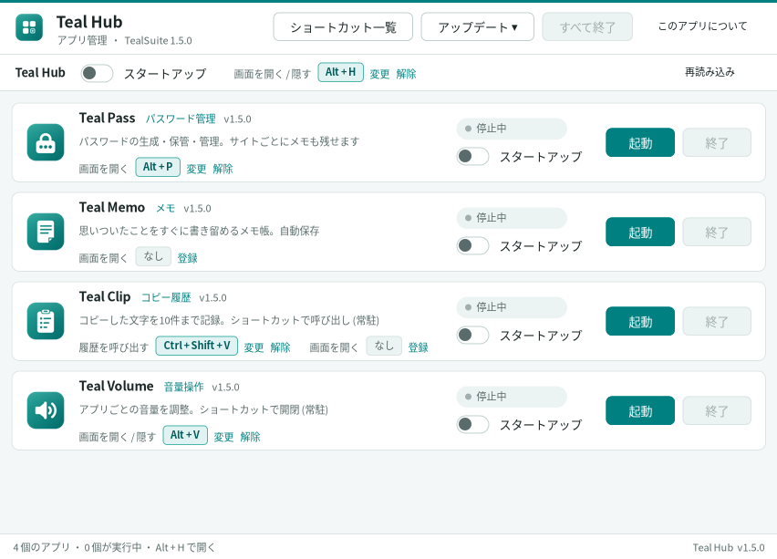
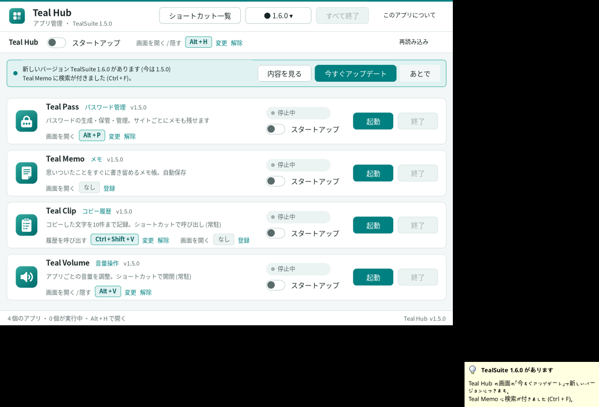

# TealSuite (ティール スイート)

Windows 用の小さなアプリのセットです。インストールは不要で、フォルダを好きな場所に置くだけで使えます。

| アプリ | できること |
|---|---|
| **Teal Hub** — アプリ管理 | ほかのアプリの起動・終了、スタートアップのオン・オフ、ショートカットの設定、アップデート |
| **Teal Pass** — パスワード管理 | パスワードを作って安全に保存 (このPC・このユーザーでしか読めません) |
| **Teal Memo** — メモ | シンプルなメモ帳 |
| **Teal Clip** — コピー履歴 | コピーした文字の履歴をいつでも呼び出し (通知領域に常駐) |
| **Teal Volume** — 音量操作 | アプリごとの音量をすばやく変更 (通知領域に常駐・Alt + V) |

動作環境: Windows 10 / 11 (.NET Framework 4.5 以上。Windows に最初から入っています)

## ダウンロード

**[Releases](https://github.com/RrioK2065/TealSuite/releases/latest)** から `TealSuite-x.y.z.zip` をダウンロードします。

1. zip を右クリック →「プロパティ」→「ブロックの解除」にチェック →「OK」
2. zip を展開して、`TealSuite` フォルダを好きな場所 (ドキュメントなど) に置く
3. `TealHub.exe` を開く

### 「Windows によって PC が保護されました」と出たとき

署名のない新しいアプリなので、初めて開くときに SmartScreen の画面が出ることがあります。
「詳細情報」→「実行」で開けます。心配なときは、Releases にある `.sha256` の値とダウンロードしたファイルの値
(PowerShell で `Get-FileHash TealSuite-x.y.z.zip`) が同じか確かめてください。

## アップデート

1.5.0 からは、Teal Hub が新しいバージョンを 1 日 1 回確認し、見つかると画面にお知らせを出します。
「今すぐアップデート」を押すとダウンロードして確認画面が出るので、そこで「アップデート」を押せば入れ替わります (データはそのまま残ります)。

- すぐ確認する: 「アップデート ▾」→「更新を確認」
- 自動の確認をやめる: 「アップデート ▾」→「自動で更新を確認する (1 日 1 回)」のチェックを外す
- 手動で入れる: Releases の `TealSuite-update-x.y.z.tealupdate` をダブルクリック
- 1.4.0 を使っている場合は、まだ自動のお知らせがないので、1.5.0 の `.tealupdate` を手動で一度入れてください。
- 1.3 以前を使っている場合は、一度だけ zip の中身でフォルダを上書きしてください。

詳しい使い方は zip に入っている `README.txt` を、変更点は [CHANGELOG.md](CHANGELOG.md) をご覧ください。

## データの保存場所

パスワードやメモなどのデータは `%APPDATA%\TealSuite` に保存されます。アプリのフォルダを入れ替えても消えません。
Teal Hub がインターネットに送るのは「最新のリリースを教えて」という問い合わせ (GitHub) だけです。

## 開発者向け

ビルド方法・リリースの手順は [DEVELOPING.md](DEVELOPING.md) にあります。
