# TealSuite (ティール スイート)

Windows 用の小さなアプリのセットです。インストールは不要で、フォルダを好きな場所に置くだけで使えます。

| アプリ | できること |
|---|---|
| **Teal Hub** — アプリ管理 | ほかのアプリの起動・終了、アプリごとの設定 (ショートカット・常駐・スタートアップ)、アップデート |
| **Teal Pass** — パスワード管理 | パスワードを作って安全に保存 (このPC・このユーザーでしか読めません)。安全チェック・お気に入り・ブラウザーの CSV 読み込み |
| **Teal Memo** — メモ | シンプルなメモ帳。ピン留め・#タグ・ゴミ箱・.txt の読み書き |
| **Teal Clip** — コピー履歴 | コピーした文字の履歴をいつでも呼び出し (Ctrl + Shift + V)。検索・定型文・記録しない設定 |
| **Teal Volume** — 音量操作 | アプリごとの音量をすばやく変更 (Alt + V)。音量のプリセット・まとめてミュート |
| **Teal Sub** — サブスク整理 | サブスクの合計金額・次の支払い日・見直し候補をひと目で。12 か月の支払い予定と予算 |
| **Teal Tasks** — タスク管理＆カレンダー | 「明日15時 歯医者」と書くだけで登録。今日やる順番とカレンダー。テンプレート・まとめて追加 |

動作環境: Windows 10 / 11 (.NET Framework 4.5 以上。Windows に最初から入っています)

## 1.8.0 で増えたこと

すべてのアプリに、あると便利な機能を追加しました。データは前の版のものをそのまま使えます。くわしくは [CHANGELOG.md](CHANGELOG.md) をご覧ください。

| アプリ | 追加した機能 |
|---|---|
| Teal Hub | 全アプリのデータをまとめてバックアップ・復元 (「その他 ▾」)、アップデート後の「更新内容」、通知領域から各アプリを開く |
| Teal Pass | お気に入り (★)、以前のパスワード、安全チェック (使い回し・弱い・1 年以上そのまま)、ブラウザーの CSV の読み込み・CSV 書き出し |
| Teal Memo | ピン留め、#タグで絞り込み、ゴミ箱 (30 日以内なら戻せる)、.txt の読み込み・書き出し、文字の大きさ |
| Teal Clip | 履歴の検索 (Ctrl+F)、定型文、文字の編集、記録の設定 (10〜50 件・自動削除・記録しない言葉・パスワードらしい文字)、一時停止 |
| Teal Volume | 音量のプリセット (「会議」「ゲーム」など)、すべてミュート / 解除、アプリの固定・非表示 |
| Teal Sub | 12 か月の支払い予定 (Ctrl+P)、月の予算、料金の変更 (値上げ) の記録、CSV から読み込み |
| Teal Tasks | くり返し「平日」「毎年」、テンプレート、まとめて追加 (Ctrl+Shift+N)、複製 (Ctrl+D)、古い完了タスクの整理 |

| Teal Hub の「その他」 | Teal Sub の支払い予定 |
|---|---|
| 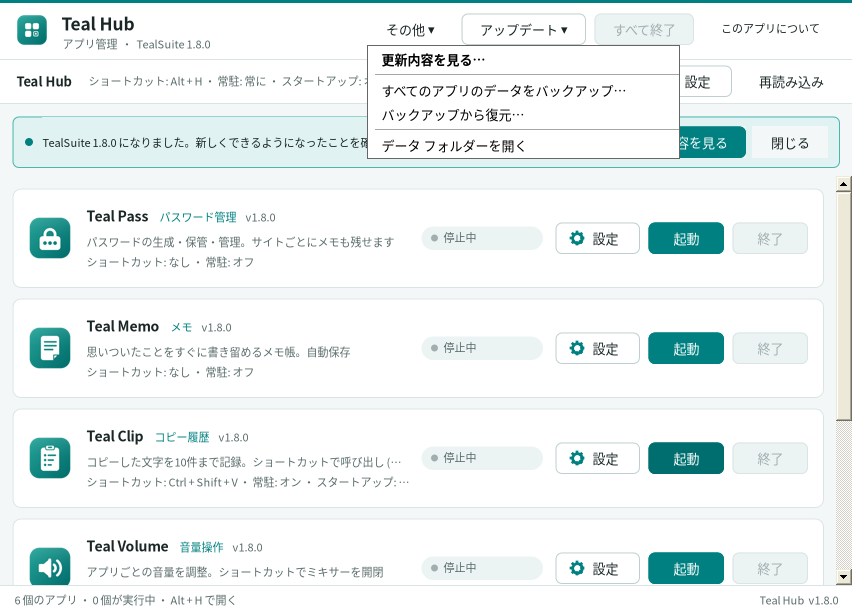 | 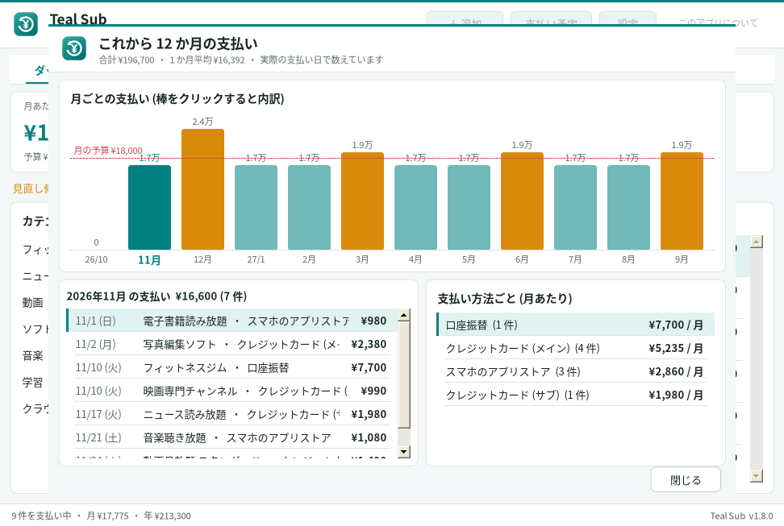 |
| **Teal Volume のプリセット** | **Teal Tasks のまとめて追加** |
| 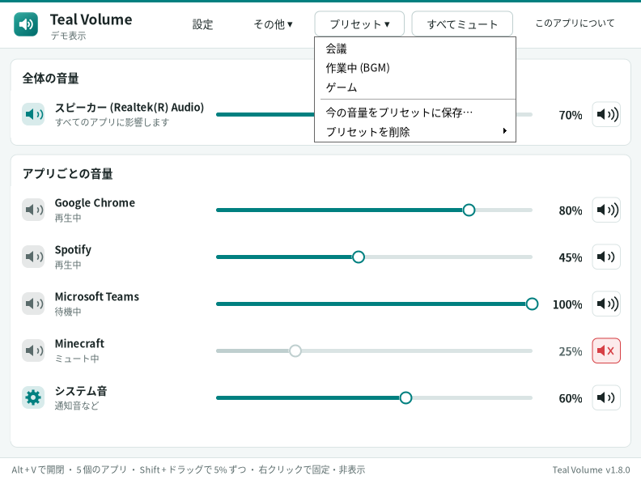 | 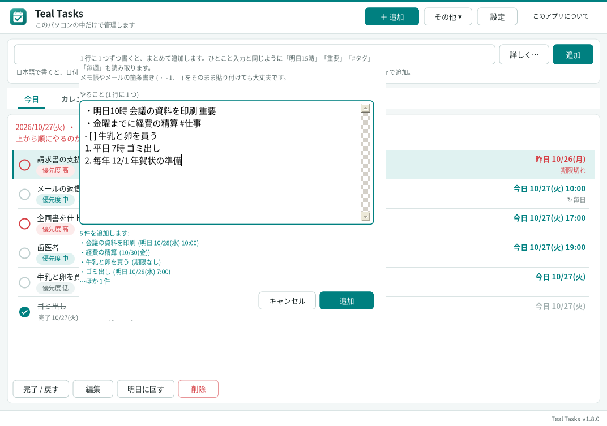 |
| **Teal Memo (ピン留め・タグ)** | **Teal Clip (検索・定型文)** |
| 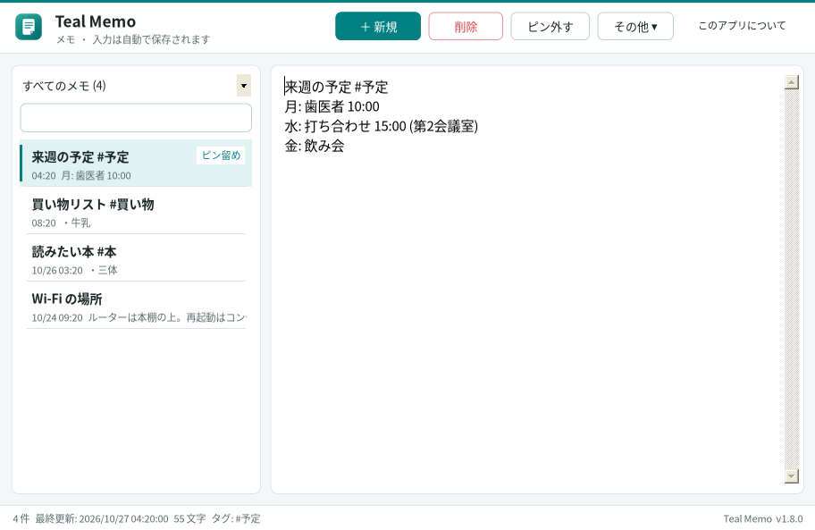 | 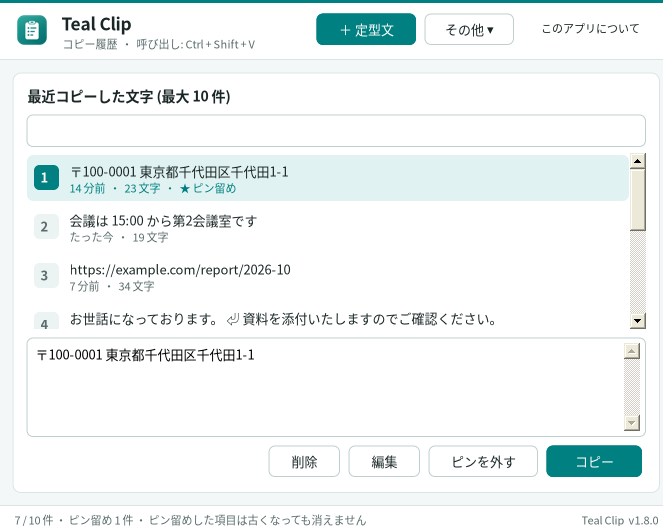 |

## Teal Sub — サブスク整理 (1.7.0)

動画・音楽・クラウドなど、毎月や毎年お金がかかっているサービスをまとめて管理します。

- **ダッシュボード** … 月あたり・1 年あたりの合計、次の支払い日、カテゴリ別の内訳
- **見直し候補** … 使う頻度・最後に使った日・1 回あたりの金額・同じカテゴリの重なりから点数をつけ、やめると年にいくら浮くかを表示
- **お知らせ** … 更新日と無料期間の終わりを 3 日前から (設定で変更可)
- **解約ガイド** … 一般的な解約の手順と、自分で登録した解約ページを開くボタン (解約の操作そのものはしません)
- **支払い予定** (1.8.0) … これから 12 か月、どの月にいくら払うかと、支払い方法ごとの金額。月の予算を決めると、超えていないかも表示
- 月払い・年払い・週払い・○か月ごと、無料期間、解約予定 / 解約済み、料金の変更の記録、CSV の書き出し・読み込み、バックアップ (JSON)

| ダッシュボード | 見直し候補 |
|---|---|
| 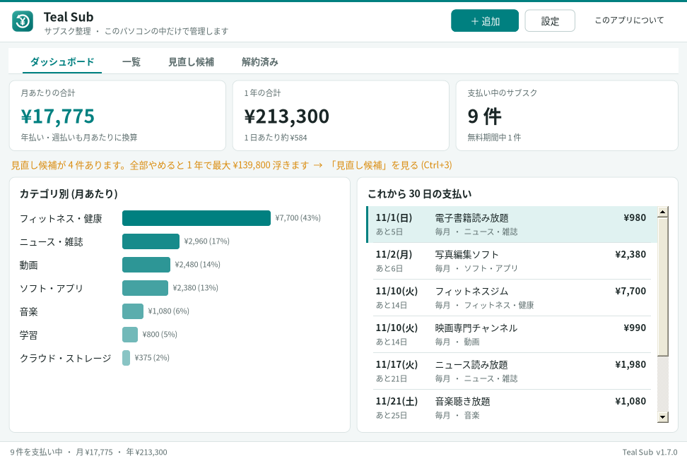 | 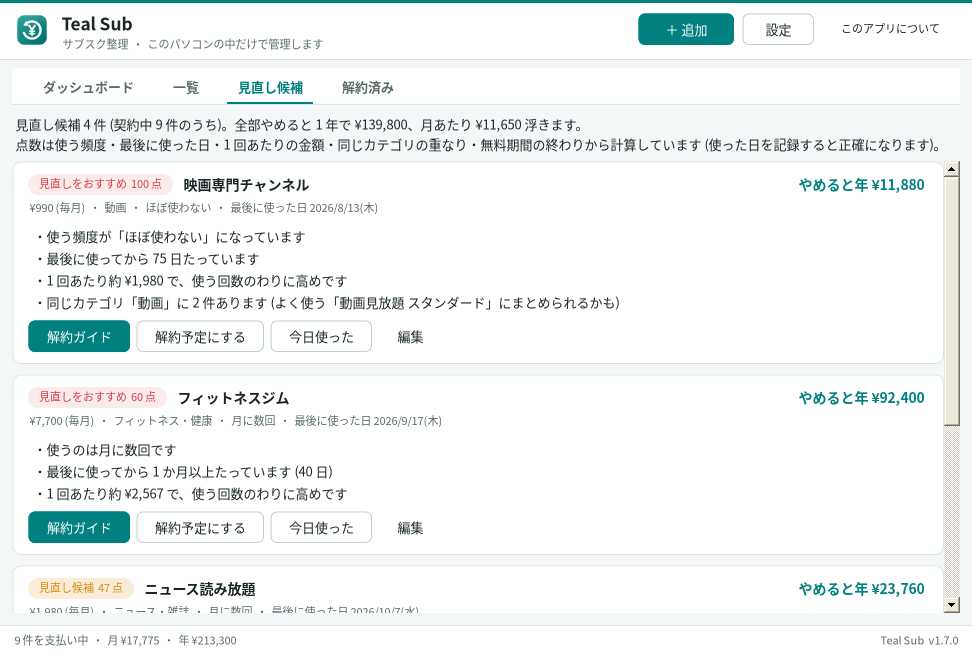 |

## Teal Tasks — タスク管理＆カレンダー (1.7.0)

上の入力欄に日本語で書いて Enter を押すだけで、期限・時刻・優先度・かかる時間・タグ・くり返しを読み取って登録します。

| 書き方の例 | 登録される内容 |
|---|---|
| `明日15時 歯医者 #病院` | 明日 15:00・タグ「病院」 |
| `金曜までにレポート提出 重要 2時間` | 金曜まで・優先度 高・2 時間 |
| `毎週水曜 ジム 1時間半` | 毎週水曜・1 時間 30 分 |
| `3時に電話` | 今日 15:00 (1〜6 時は午後とみなします) |
| `平日 9時 朝会` | 月〜金の 9:00 にくり返し (1.8.0) |
| `毎年 12/1 年賀状の準備` | 毎年 12/1 (1.8.0) |

- **今日** … 期限切れと今日のタスクを、期限の近さ・優先度・かかる時間から「おすすめ順」に並べます
- **カレンダー** … 月・週・日。ドラッグで日時を変更、日の「＋」で追加
- **お知らせ** … 時刻つきのタスクは 15 分前、その日のタスクは朝にまとめて
- くり返し (毎日・平日・毎週・毎月・毎年)、小タスク、検索、統計、CSV 書き出し、Ctrl+Z で元に戻す
- 「その他 ▾」(1.8.0) … テンプレートから追加、まとめて追加 (1 行に 1 件)、複製、古い完了タスクの整理

| 今日 | 月のカレンダー |
|---|---|
| 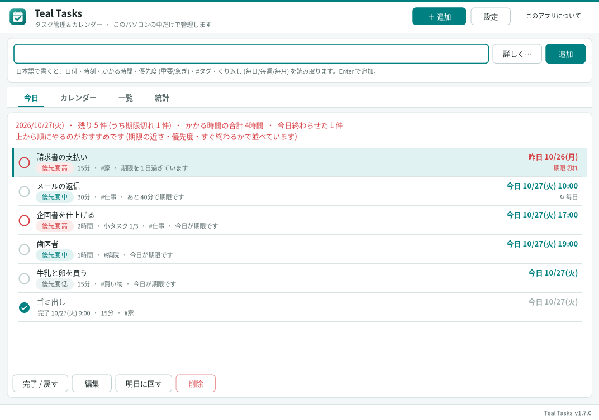 | 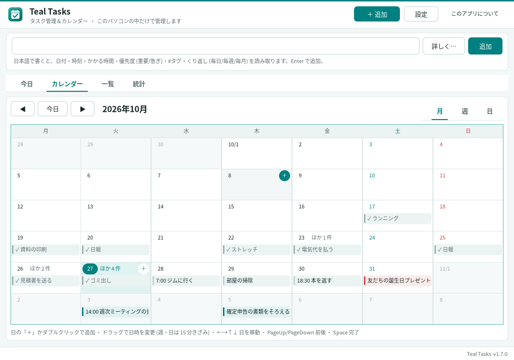 |
| **週のカレンダー** | **統計** |
| 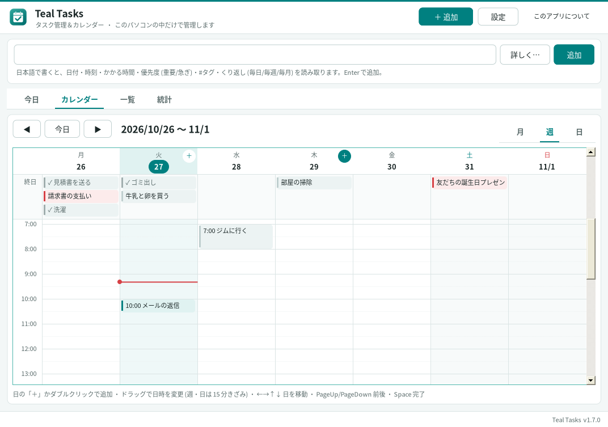 | 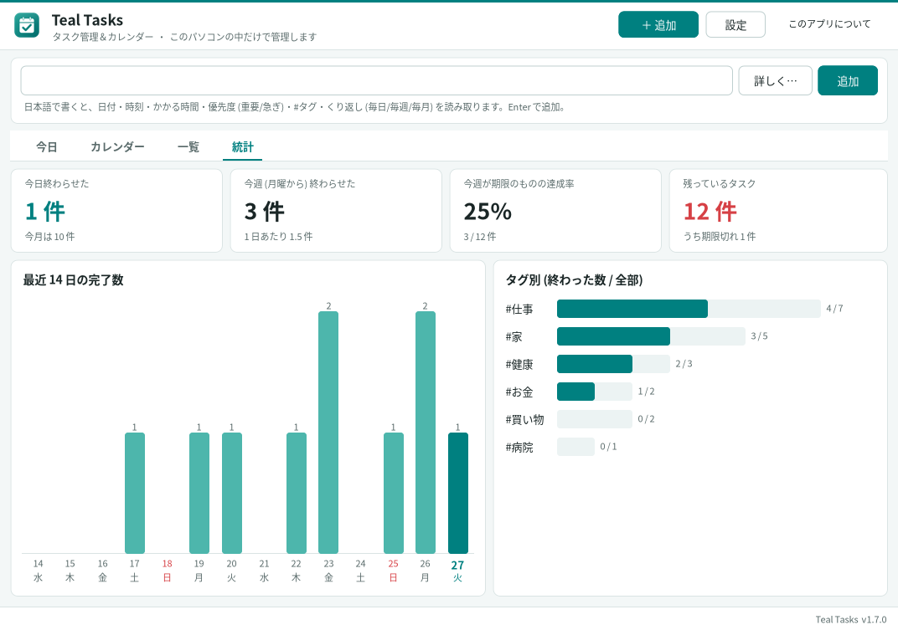 |

Teal Sub と Teal Tasks は AI もインターネットも使いません。お知らせは起動している間だけ出せるので、初期設定で「常駐」がオンです
(× で閉じても通知領域に残ります)。パソコンの起動時から動かしたいときは、Teal Hub の「⚙ 設定」で「スタートアップ」をオンにしてください。

## アプリごとの設定 (1.6.0)

Teal Hub の各カードにある「⚙ 設定」を押すと、画面がそのアプリの設定に切り替わります (「← 戻る」で一覧へ)。

- **ショートカット** … すべて Teal Hub が受け付けます。アプリが起動していなくても、押せば起動します
- **常駐** … オンにすると、× で閉じても通知領域に残ります (初期設定は Teal Clip・Teal Sub・Teal Tasks がオン)
- **スタートアップ** … Windows の起動時に自動で起動します (常駐がオンのアプリだけ選べます)

| 一覧 (⚙ 設定) | Teal Clip の設定 |
|---|---|
|  | 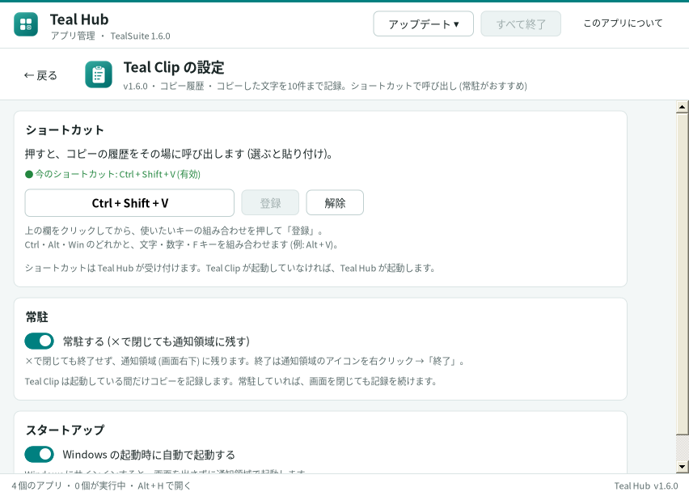 |
| **Teal Volume の設定** | **Teal Hub の設定** |
| 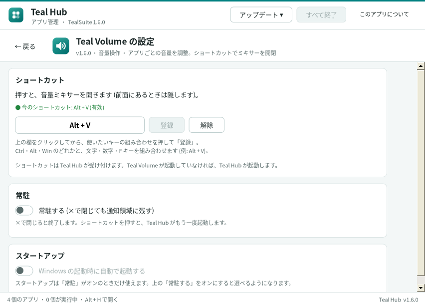 | 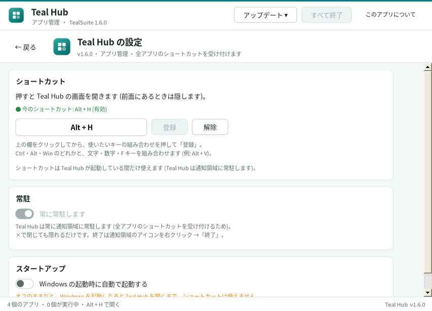 |

## ダウンロード

**[Releases](https://github.com/RrioK2065/TealSuite/releases/latest)** から `TealSuite-x.y.z.zip` をダウンロードします。

1. zip を右クリック →「プロパティ」→「ブロックの解除」にチェック →「OK」
2. zip を展開して、`TealSuite` フォルダを好きな場所 (ドキュメントなど) に置く
3. `TealHub.exe` を開く

### 「Windows によって PC が保護されました」と出たとき

署名のない新しいアプリなので、初めて開くときに SmartScreen の画面が出ることがあります。
「詳細情報」→「実行」で開けます。心配なときは、Releases にある `.sha256` の値とダウンロードしたファイルの値
(PowerShell で `Get-FileHash TealSuite-x.y.z.zip`) が同じか確かめてください。

## アップデート

1.5.0 からは、Teal Hub が新しいバージョンを 1 日 1 回確認し、見つかると画面にお知らせを出します。
「今すぐアップデート」を押すとダウンロードして確認画面が出るので、そこで「アップデート」を押せば入れ替わります (データはそのまま残ります)。

- すぐ確認する: 「アップデート ▾」→「更新を確認」
- 自動の確認をやめる: 「アップデート ▾」→「自動で更新を確認する (1 日 1 回)」のチェックを外す
- 手動で入れる: Releases の `TealSuite-update-x.y.z.tealupdate` をダブルクリック
- 1.6.0 から 1.7.0 にすると、Teal Sub と Teal Tasks が Teal Hub の一覧に自動で加わります。
- 1.8.0 にしたあとは、Teal Hub に「更新内容を見る」のお知らせが 1 回出ます (「その他 ▾」→「更新内容を見る…」でいつでも見られます)。
- 1.4.0 を使っている場合は、まだ自動のお知らせがないので、1.5.0 の `.tealupdate` を手動で一度入れてください。
- 1.3 以前を使っている場合は、一度だけ zip の中身でフォルダを上書きしてください。

詳しい使い方は zip に入っている `README.txt` を、変更点は [CHANGELOG.md](CHANGELOG.md) をご覧ください。

## データの保存場所

パスワード・メモ・サブスク・タスクなどのデータは `%APPDATA%\TealSuite` に保存されます。アプリのフォルダを入れ替えても消えません。
Teal Hub の「その他 ▾」→「すべてのアプリのデータをバックアップ…」で、まとめて 1 つの zip に保存できます (Teal Pass と Teal Clip は暗号化されたまま入るので、同じ Windows ユーザーでしか開けません)。
Teal Hub がインターネットに送るのは「最新のリリースを教えて」という問い合わせ (GitHub) だけです。

## 開発者向け

ビルド方法・リリースの手順は [DEVELOPING.md](DEVELOPING.md) にあります。
